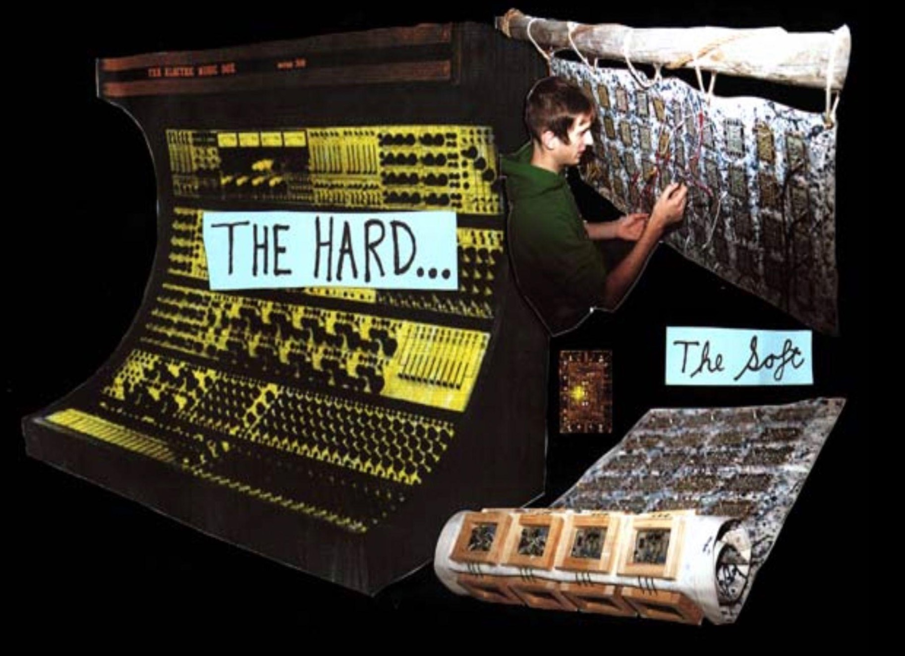
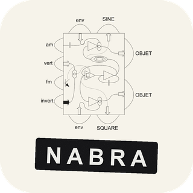
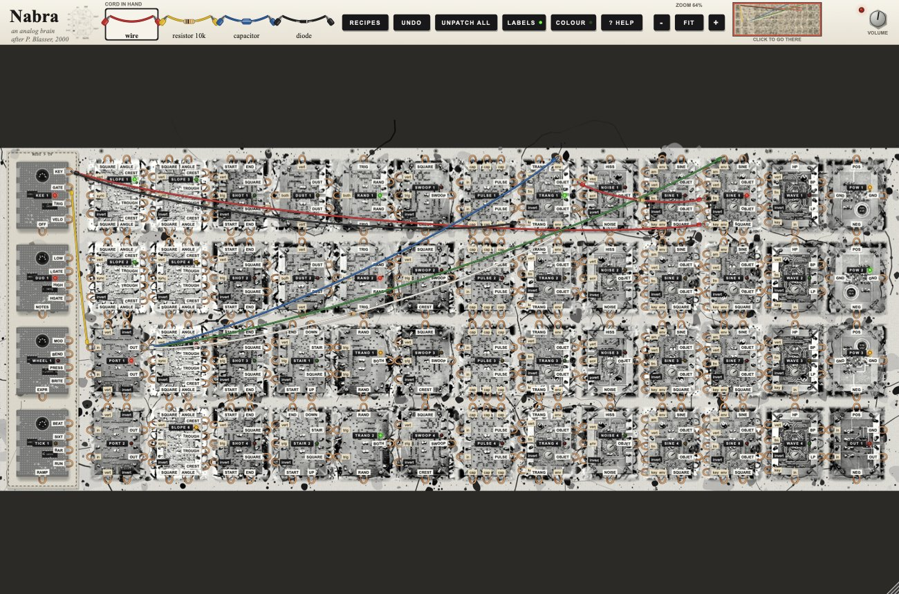
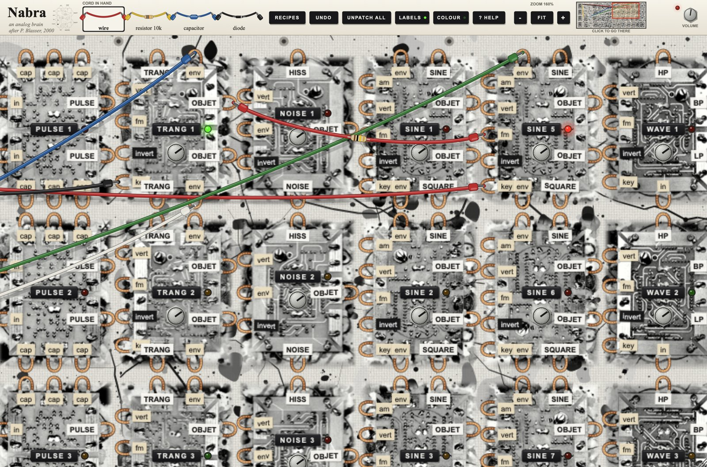
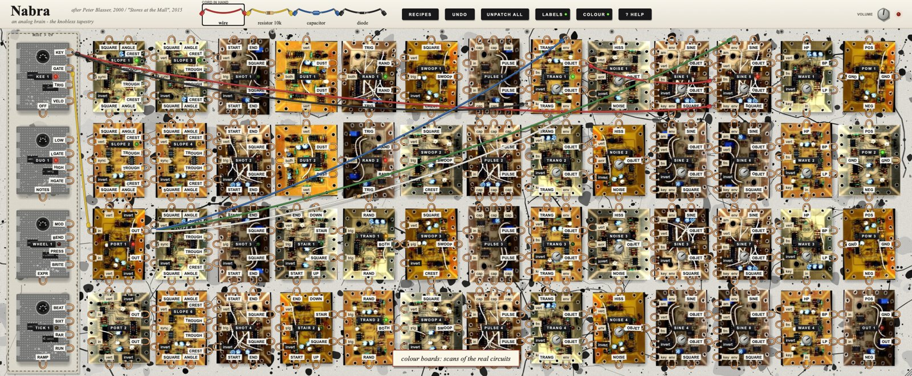

<p align="center">
  
</p>

<p align="center">
  
</p>

<h1 align="center">Nabra</h1>

<p align="center">
  <b>An analog brain: the knobless tapestry synthesizer, as a VST3 / AU / LV2 instrument and a desktop app.</b><br>
  macOS · Windows · Linux
</p>

<p align="center">
  <a href="https://github.com/femifleming/nabra/releases/latest"><b>Download</b></a> ·
  <a href="#install">Install</a> ·
  <a href="docs/HELP.md">Help</a> ·
  <a href="#the-thesis">Peter Blasser's thesis</a>
</p>

---

Nabra rebuilds the **Nabra**, the hanging "analog brain" tapestry synthesizer by **Peter Blasser** (2000). He describes it in
his Wesleyan thesis *Stores at the Mall* (2015). Fifty-two circuit boards face out of a splatter-painted canvas. Loops of
braided copper act as patch points, joined by alligator-clip cords. The original has no tuning knobs. Every module
has a fixed tuning, and you change it only by patching something into it.

This version adds a sewn-on **MIDI-to-CV strip** so you can play it from a keyboard or a DAW. It also adds **cords with parts
in them** (wire, resistor, capacitor, diode), as the thesis intended.



**Zoom in and patch.** The desktop app and the plug-in share the same view. Pinch or ⌘/Ctrl-scroll to zoom up to 250%.
Swipe, scroll or drag the bare canvas to pan. Use the minimap in the top bar to jump anywhere. When a cord reaches the
edge of the window, the view scrolls along with it.



**Two looks.** The default theme uses the black-and-white board photographs from the thesis. Press **COLOUR** in the
top bar to switch to colour scans of the real circuit boards:



## The thesis

> Peter Blasser, *Stores at the Mall*, MA thesis in Music, Wesleyan University, May 2015.
> Advisors: Ron Kuivila, David Behrman, Jonathan Zorn.
>
> **[Read the thesis and its chapter on the Nabra at Wesleyan Digital Collections →](https://digitalcollections.wesleyan.edu/documents/detail/stores-at-the-mall/213035)**

The modules, their layout, the patch "recipes" and the quotations in the in-app help all come from the Nabra chapter.
The board photographs and module diagrams in `Resources/` come from that document. The thesis is
*In Copyright – Non-Commercial Use Permitted*. They are included here for non-commercial, educational use, with credit to
Peter Blasser. Wesleyan may only show the full scan on some networks. If it won't open, try from a campus network or ask
Wesleyan's library.

## Install

Every release has ready-made downloads on the **[Releases page](https://github.com/femifleming/nabra/releases/latest)**.

| Platform | Desktop app | Plug-ins |
|---|---|---|
| macOS 11+ (Apple Silicon & Intel) | `Nabra.app` | VST3, AU |
| Windows 10/11 (x64) | `Nabra.exe` (Start menu / desktop shortcut) | VST3 |
| Linux x86_64 | `Nabra` (applications menu entry) | VST3, LV2 |

### Homebrew (macOS and Linux)

```sh
brew tap femifleming/tap
brew trust --tap femifleming/tap
```

**macOS** installs the app into `/Applications` and the plug-ins into `~/Library/Audio/Plug-Ins`:

```sh
brew install --cask femifleming/tap/nabra
```

**Linux** (Homebrew on Linux) installs the app, then links the plug-ins and a menu entry into your home folder:

```sh
brew install --formula femifleming/tap/nabra
nabra-link-plugins        # ~/.vst3, ~/.lv2 and an applications-menu entry
```

To update, run `brew upgrade`. To remove, run `brew uninstall --cask nabra` on macOS, or `nabra-link-plugins --remove && brew uninstall nabra` on Linux.

### Windows

Download **`Nabra-x.y.z-Windows-Setup.exe`** and run it. It installs the app with Start-menu and optional desktop shortcuts,
and puts the VST3 in `C:\Program Files\Common Files\VST3`. There's also a portable `.zip`. You can also install with
[Scoop](https://scoop.sh):

```powershell
scoop bucket add femifleming https://github.com/femifleming/homebrew-tap
scoop install femifleming/nabra
```

Homebrew doesn't run on Windows, which is why there's a Scoop bucket. The builds aren't code-signed yet, so Windows
SmartScreen may warn you. Click **More info → Run anyway**.

### macOS without Homebrew

Unzip `Nabra-x.y.z-macOS.zip`, drag **Nabra.app** to Applications, then copy the plug-ins:

```sh
cp -R Nabra.vst3 ~/Library/Audio/Plug-Ins/VST3/
cp -R Nabra.component ~/Library/Audio/Plug-Ins/Components/
xattr -dr com.apple.quarantine /Applications/Nabra.app ~/Library/Audio/Plug-Ins/VST3/Nabra.vst3 ~/Library/Audio/Plug-Ins/Components/Nabra.component
```

The builds are ad-hoc signed, not notarized. The `xattr` line stops Gatekeeper from saying the app "is damaged". The
Homebrew cask runs that step for you.

### Linux without Homebrew

```sh
tar xzf Nabra-x.y.z-Linux-x86_64.tar.gz
cd Nabra-x.y.z-Linux-x86_64
./install.sh              # per user: ~/.local/bin, ~/.vst3, ~/.lv2, menu entry
# sudo ./install.sh --system   # everyone: /usr/local
# ./install.sh --uninstall
```

It needs ALSA, FreeType, fontconfig and X11, which nearly every desktop distro already has. JACK works if it's installed.

## Quick start

1. Open **Nabra** (the app), or load it on an instrument track in your DAW.
2. Play your MIDI keyboard. Recipe **4. Kee sings** loads at startup, so you hear sound right away. In the app, pick your
   audio and MIDI devices under **Options** (top-left).
3. Click **UNPATCH ALL**, then drag from a copper loop marked in CAPITALS (an output) to a lowercase loop (an input).
   Start with **Slope 3 ANGLE → Sine 5 env**.
4. Click **? HELP** for the full illustrated guide. Right-click any board for its own help page.

| Action | How |
|---|---|
| Patch | drag from an output loop to an input loop (either direction) |
| Move a cord | drag it off an input loop; drop it on bare canvas to delete it |
| Delete a cord | double-click it, or right-click → remove |
| Change a cord's part | pick wire / resistor / capacitor / diode in the top bar, or right-click a cord |
| Undo | **⌘Z** (macOS) or **Ctrl+Z** (Windows/Linux), or **UNDO** |
| Recipes | **RECIPES**: 3 from the thesis, 4 using the MIDI strip |
| Zoom | pinch, ⌘/Ctrl + scroll, **−** / **+** buttons or keys; **FIT** (or **0**) shows everything |
| Pan | two-finger swipe / scroll wheel (Shift = sideways), drag bare canvas, arrow keys, or click the minimap |
| Labels on/off | **LABELS** hides the tape labels, like the unlabelled original |
| Theme | **COLOUR** switches between thesis photos and colour board scans |
| Help | **? HELP**, or right-click a board |

The full manual, with every module and every patch point, is in **[docs/HELP.md](docs/HELP.md)**.

## Build from source

You need CMake 3.22+, a C++20 compiler, and Ninja (optional). JUCE 9.0.5 downloads automatically. To use your own copy,
put a JUCE checkout in `./JUCE`.

```sh
git clone https://github.com/femifleming/nabra.git && cd nabra
cmake -B build -G Ninja -DCMAKE_BUILD_TYPE=Release
cmake --build build
```

- **macOS:** builds a universal (arm64 + x86_64) AU, VST3 and app. The plug-ins are copied into `~/Library/Audio/Plug-Ins`.
- **Windows:** use `cmake -B build -G "Visual Studio 17 2022" -A x64 -DNABRA_COPY_PLUGINS=OFF`, then
  `cmake --build build --config Release`.
- **Linux:** first install the dependencies:
  `sudo apt install libasound2-dev libjack-jackd2-dev libfreetype-dev libfontconfig1-dev libx11-dev libxcomposite-dev libxcursor-dev libxext-dev libxinerama-dev libxrandr-dev libxrender-dev libxi-dev libglu1-mesa-dev`.

The build output goes to `build/Nabra_artefacts/Release/{Standalone,VST3,AU,LV2}`. Add `-DNABRA_COPY_PLUGINS=OFF` to skip
copying into the system plug-in folders.

**Tests:** `build/NabraTest_artefacts/Release/NabraTest <dir>` renders every recipe to WAV and checks the levels.
`build/NabraSnapshot_artefacts/Release/NabraSnapshot <dir>` renders the GUI (both themes and the help pages) to PNG.
CI runs both on all three platforms. Every tag `v*` builds and publishes a release.

```
Source/Specs.cpp     module definitions, jack layout, help text, recipes
Source/Engine.cpp    per-sample DSP for every module (2x oversampled)
Source/Art.cpp       canvas splatter, photos, board scans, copper loops, tapes, cords
Source/Help.cpp      the in-app help book
Resources/photos     board photos from the thesis      Resources/boards   colour board scans
Resources/diagrams   module diagrams from the thesis   Resources/icon     app icon
packaging/           Linux desktop entry + installer, Windows Inno Setup script
```

## Human contributions

Nabra's code was written with Claude Code (Anthropic), working under the direction of its author, [femifleming](https://github.com/femifleming). This is what the author brought to it:

- **The concept and source material.** The author chose Peter Blasser's Wesleyan thesis *Stores at the Mall* and asked for its Nabra chapter to be made into a playable modular instrument.
- **The visual direction.** The instrument should look like the thesis, using the paper's images as its aesthetic.
- **The MIDI-to-CV module.** A module that turns the plug-in's incoming MIDI into patchable control voltage.
- **The built-in help.** In-app help that explains how to patch it, plus instructions and this README.
- **Scope.** Nabra is its own instrument, separate from the author's other plug-ins.
- **Testing and sign-off.** The author tried the build, approved it as final, and asked for the sister version Nabruh, the same instrument with a bigger interface for laptop screens.
- **The release.** A public GitHub release that installs through Homebrew and runs on macOS, Windows and Linux, as a plug-in and as a desktop app.
- **Credit to Blasser.** A link to Blasser's dissertation chapter on this page, and the decision to publish with the thesis images.
- **The logo and zoom.** A logo taken from the dissertation, and a desktop app you can zoom and pan around like the plug-in.

## Credits & license

- The Nabra instrument, its design, the photographs, the diagrams and the quoted text are by **Peter Blasser**, from
  *Stores at the Mall* (Wesleyan University, 2015), and are used with credit for non-commercial purposes.
- The logo is Blasser's hand-drawn **Sine** module diagram from the thesis. The app icon is the letter n in Septambres Neau.
- Built with [JUCE](https://juce.com). The code in this repository is licensed under the **GNU AGPL v3** ([LICENSE](LICENSE)),
  matching JUCE's open-source license.

## Request log

Everything that was asked for while this was designed and built is in [REQUESTS.md](REQUESTS.md).
